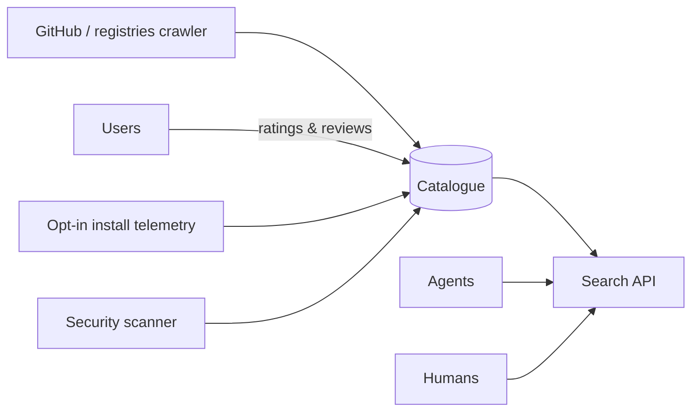

# Architecture — skillscout

## 1. Scope
Discovery and comparison for agent skills (SKILL.md packages; later MCP servers and actions).
**MVP:** indexer (frontmatter parser), static quality score, ratings (one per user), BM25 search
blended with quality and Bayesian ratings, comparison grid, JSON catalogue.
**Product:** GitHub and registry crawler, install telemetry, security scanning, trust badges.

## 2. System context

## 3. Ranking
`score = BM25(query, name×2 + description×2 + tags + body) × (0.6 + 0.4·quality/100) × (0.7 + 0.3·bayes_rating/5)`.
Relevance dominates, and quality and ratings re-rank within the relevant set. Doubling name and
description is a cheap field boost.

**Quality signals:** a "use when" trigger phrase (agents decide *when* to load a skill from this),
description length in the useful range, structured body (headings, steps, code), bundled
scripts or references, a version, and a TODO/placeholder penalty.

## 4. Design decisions
- **A dependency-free frontmatter parser** for the YAML subset used by SKILL.md (scalars, inline
  lists, block lists, folded continuations). *Trade-off:* exotic YAML isn't supported, so the
  product swaps in a real YAML parser behind the same function.
- **Bayesian ratings** (prior 3.5, weight 3), so a single 5★ doesn't top the charts.
- Skills without a description are skipped, because agents can't use them anyway.

## 5. Production architecture
A crawler queue (GitHub code search + registry APIs), Postgres + OpenSearch for search,
embeddings for semantic search (hybrid BM25 + vector), and a security scanner that statically
flags shell execution, network egress and credential access in bundled scripts.

## 6. Risks
Skill authors gaming quality signals, so telemetry-based retention (still enabled after 30 days)
becomes the main ranking signal once there's volume.

## 7. Limitations (sell-ready audit, 2026-10-27)
- No feature gating by plan: every API key unlocks the same software. Team/Business
  pricing is support and onboarding, not gated features; approved-skill lists, policy
  enforcement, and audit export are roadmap, not shipped, and were removed from sales copy.
- The bundled starter catalog is a snapshot: it must match a fresh index of
  examples/skills (enforced by a test), and it is not a live crawl of GitHub or registries.
- Risk flags are static pattern matches over SKILL.md text and bundled scripts; they are
  not a sandbox, a full security audit, or a guarantee that a skill is safe.
- Docker build and a live Render/Fly deployment were not verified in the audit environment
  (no Docker binary there); Dockerfile, render.yaml, and fly.toml are the same template
  shape as vibe-lube, but a deployment claim remains "not verified" until one is made.
- Stripe prices were not verified against a live Stripe account in this run; checkout and
  revocation are covered in tests with mocked Stripe calls, and the README example now
  uses developer/team/business plan keys to match the plan names.
