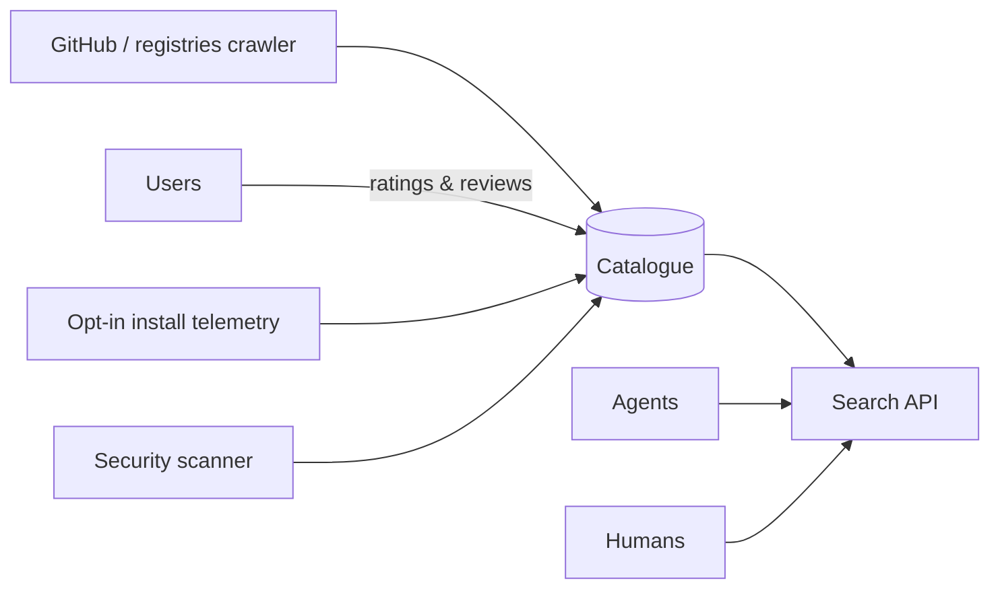

# Architecture — skillscout

## 1. Scope
Discovery and comparison for agent skills (SKILL.md packages; later MCP servers and actions).
**MVP:** indexer (frontmatter parser), static quality score, ratings (one per user), BM25 search
blended with quality and Bayesian ratings, comparison grid, JSON catalogue.
**Product:** GitHub and registry crawler, install telemetry, security scanning, trust badges.

## 2. System context

## 3. Ranking
`score = BM25(query, name×2 + description×2 + tags + body) × (0.6 + 0.4·quality/100) × (0.7 + 0.3·bayes_rating/5)`.
Relevance dominates, and quality and ratings re-rank within the relevant set. Doubling name and
description is a cheap field boost.

**Quality signals:** a "use when" trigger phrase (agents decide *when* to load a skill from this),
description length in the useful range, structured body (headings, steps, code), bundled
scripts or references, a version, and a TODO/placeholder penalty.

## 4. Design decisions
- **A dependency-free frontmatter parser** for the YAML subset used by SKILL.md (scalars, inline
  lists, block lists, folded continuations). *Trade-off:* exotic YAML isn't supported, so the
  product swaps in a real YAML parser behind the same function.
- **Bayesian ratings** (prior 3.5, weight 3), so a single 5★ doesn't top the charts.
- Skills without a description are skipped, because agents can't use them anyway.

## 5. Production architecture
A crawler queue (GitHub code search + registry APIs), Postgres + OpenSearch for search,
embeddings for semantic search (hybrid BM25 + vector), and a security scanner that statically
flags shell execution, network egress and credential access in bundled scripts.

## 6. Risks
Skill authors gaming quality signals, so telemetry-based retention (still enabled after 30 days)
becomes the main ranking signal once there's volume.
